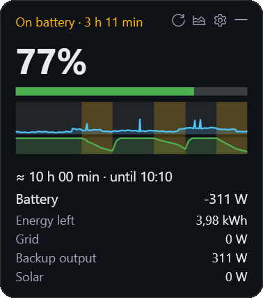
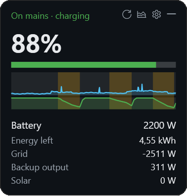
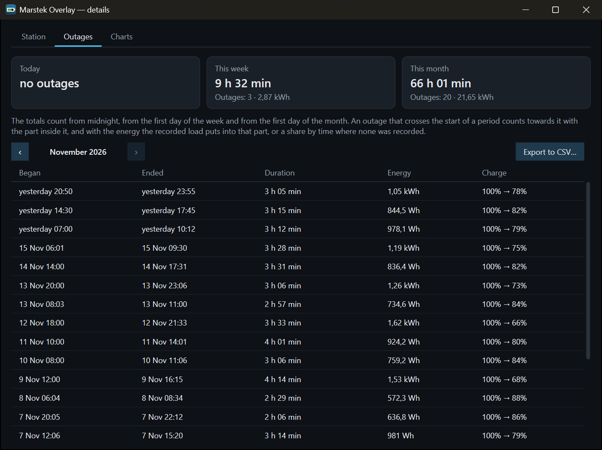
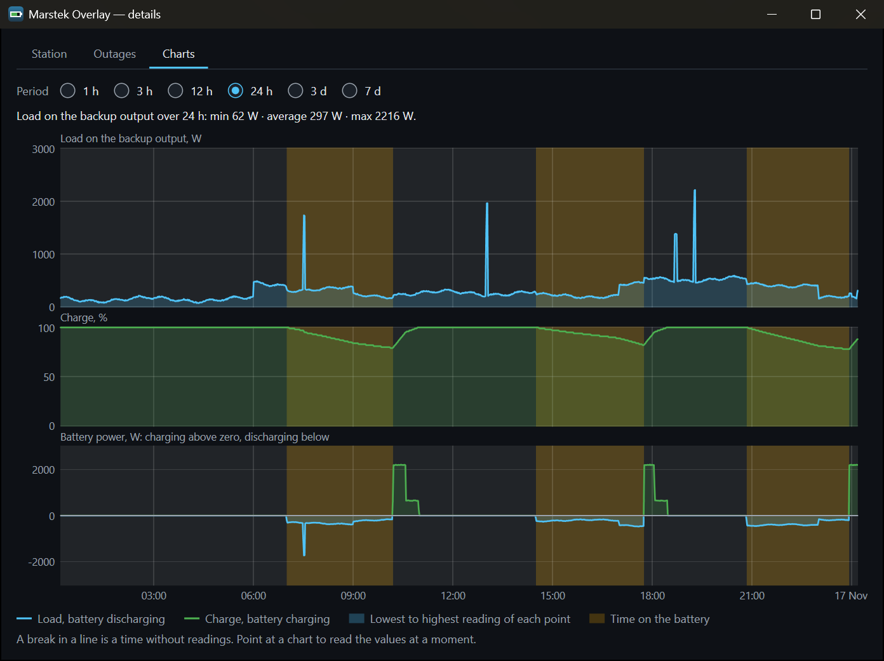
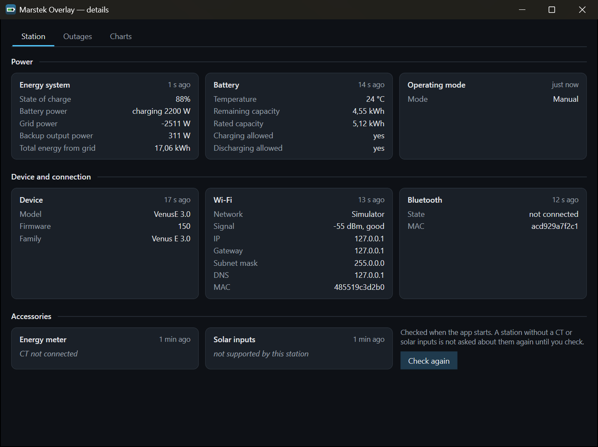
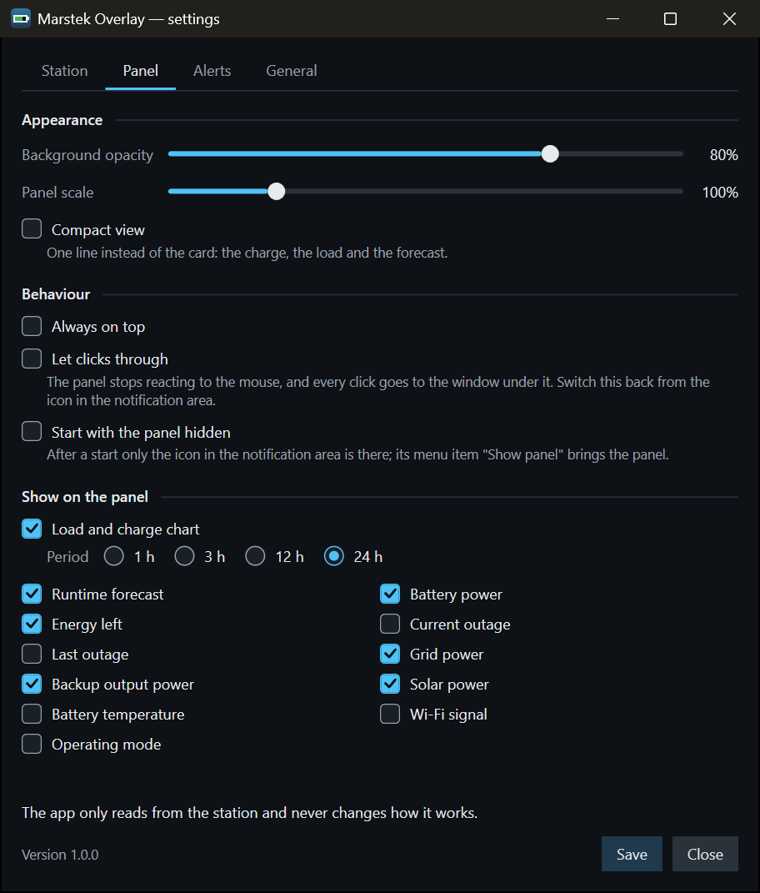

# Marstek Overlay

**English** · [Українська](README.uk.md)

A translucent panel for Windows that shows the state of a Marstek power station (Venus A / C / D / E / E mini): where the power comes from right now, how much charge is left and how long it will last. The data comes straight from the station over its local Open API on the home network, with no cloud involved. The app only reads — it changes nothing on the station.

It suits best a station that works as an uninterruptible power supply: the load on the BACKUP output, the mains on the input.

  
  &nbsp;&nbsp;
  

  

> An independent project, not affiliated with or endorsed by Marstek.

## What it does

- **Tells the power source at a glance** — on mains, charging, or on battery and for how long.
- **Forecasts the runtime** — until the charge is down to the reserve, until the battery is full, or how long it would last if the mains failed now.
- **Notifies through Windows** when the mains is lost or back, the charge comes down to a threshold, the battery is too hot or too cold, or the station stops answering.
- **Keeps an outage journal** by month, with totals and an export to CSV.
- **Draws charts** of the load, the charge and the battery power over up to a week.
- **Lives in the tray** as a battery icon that shows the charge, with a compact one-line view, click-through and always-on-top modes for the panel.
- **Speaks English and Ukrainian.**
- **Stays local**: no account, no cloud, nothing sent anywhere but to the station.

## Getting started

You need Windows 10 or 11 (x64), the computer and the station on the same local network, and Open API (Local API) switched on in the Marstek app with a UDP port set (30000 by default).

Take a file from the [latest release](https://github.com/Qyperion/MarstekOverlay/releases/latest):

| File | What it is |
|---|---|
| `MarstekOverlay-Setup-<version>.exe` | **The installer — the usual choice.** Installs for the current user without administrator rights and needs nothing else. |
| `MarstekOverlay-<version>-win-x64-self-contained.exe` | Portable: one file that needs nothing else. Put it anywhere and run it. |
| `MarstekOverlay-<version>-win-x64.exe` | Portable: one small file that needs the [.NET 11 Desktop Runtime](https://dotnet.microsoft.com/download/dotnet/11.0). |

The files are not signed, so on the first start Windows SmartScreen may say the publisher is unknown: **More info → Run anyway**.

On the first start the settings window opens: press **Find stations on the network**, choose yours, then **Test connection** and **Save**.

An update — the newer installer, or the newer exe in place of the old one — keeps the settings and the history: they live apart from the program, in `%APPDATA%\MarstekOverlay`.

## Panel and tray icon

- **Header** — the power source: "On mains", "On mains · charging" or "On battery · 2 h 15 min". The duration is marked "at least" when the app did not see the switch itself.
- **Charge** — a number and a bar that turns yellow from the highest alert threshold and red from the lowest.
- **Chart** of the load and the charge over the last 1 to 24 hours; time on the battery is shaded yellow.
- **Warnings** — for example "⚠ Low charge (threshold 30%)", for as long as they hold.
- **Rows** — the power of the battery, the grid, the BACKUP output and the solar panels, and the forecast while on the battery. Energy left, the current and the last outage, the battery temperature, the Wi-Fi signal and the operating mode can be added in the settings.

A click on the panel or a drag does not take the keyboard away from the window you are working in. Its context menu and the menu of the tray icon switch the modes: **Compact view** (one line, "100% 575 W · ≈ 7 h 10 min"), **Always on top** and **Let clicks through** — switched back from the tray icon, since the panel then ignores the mouse.

The tray icon is a battery filled to the charge. A yellow triangle means the station runs on the battery, a red cross that it is not answering; a double click hides or shows the panel.

## Forecast

- **On the battery** — until the charge is down to the reserve level: "≈ 9 h 00 min · until 07:40 tomorrow".
- **While charging** — when the battery will be full: "Full in ≈ 1 h 20 min · by 00:10".
- **On the mains with the battery charged** — how long the battery would last if the mains failed now: "Would last ≈ 14 h 30 min".

The forecast rests on the power averaged over the last 5 minutes. On the mains it is on the compact line and in the tooltip of the tray icon rather than on the panel. The reserve level and the losses of discharging and charging are set on the **General** tab of the settings.

## Notifications

| Notification | When |
|---|---|
| Mains power lost | the station has switched to the battery |
| The station is running on the battery | the outage began while the app was not following the station: it was started during the outage, the computer slept, or the station had been silent for long |
| Mains power is back | the outage is over; the text gives how long it lasted and the energy it took |
| Charge down to a threshold | the thresholds are 50, 30 and 15% by default |
| Battery temperature out of range | 5–45 °C by default |
| Charging or discharging forbidden | the station itself reports so |
| The station is not answering | for longer than 5 minutes by default |

Each one comes once and is not repeated until its cause has gone. The kinds, the thresholds and the limits are set on the **Alerts** tab.

## Details window

- **Station** — everything the station reports, as cards: energy system, battery, operating mode, device, Wi-Fi, Bluetooth, energy meter and solar inputs. A card whose data has stopped coming turns yellow.
- **Outages** — the journal by month: start, end, duration, energy taken, change of charge, with totals for today, this week and this month. **Export to CSV…** saves a month as a file for Excel.
- **Charts** — the load, the charge and the battery power over a period from an hour to a week.

  

  

More screenshots: the Station tab and the settings

  

  

## Settings and data

The settings window has four tabs: **Station** (address, search, connection test), **Panel** (look, behaviour and what is shown), **Alerts** and **General** (language, start with Windows, the forecast, deleting stored data). The look of the panel applies at once; the station address and the numbers apply after **Save**.

The data of the app is in `%APPDATA%\MarstekOverlay`: the settings in `settings.json`, the outage journal and the measurements for the charts in `history.db`, the diagnostic log in `diagnostics.log`. The journal is kept until you delete it, the measurements for 7 days. **Delete stored data** on the **General** tab clears the measurements, the journal or the log, whole or except for the last day, week or month.

The station is polled every 30 seconds. The intervals, the depth of the history and the requests that are never sent are set in `appsettings.json` next to the exe; a portable exe comes without that file, so create it there — see [docs/Configuration.md](docs/Configuration.md).

## Good to know

- **The station does not report whether the mains is there,** so the app concludes it from the readings. The rule is made for a station that charges to 100% whenever the mains is present. If charging is limited by a schedule or a level, running on the mains without charging will look like an outage.
- **An outage is declared up to a minute late,** and one that began on a full battery several minutes later still: only when the charge has dropped to 99% and stayed there for two minutes. Such an outage is dated by that drop, so its duration and energy are marked "at least".
- **If the station behaves erratically,** try switching the `Bat.GetStatus` request off: by reports of the community, some firmware restarts on it. Add `"Bat.GetStatus"` to `Polling:DisabledMethods` in `appsettings.json`.
- **If the app fails,** it shows the error and the path of the diagnostic log and closes; start it again.
- Checked on a Venus E 3.0 with firmware 150. Reports about other models and firmware are welcome in the [issues](https://github.com/Qyperion/MarstekOverlay/issues/new/choose).

## Documentation

The technical details are in the [docs](docs) folder:

- [Architecture.md](docs/Architecture.md) — what the app is made of
- [MarstekLocalApi.md](docs/MarstekLocalApi.md) — the station's protocol: methods, fields, units by firmware
- [StationBehaviour.md](docs/StationBehaviour.md) — what was measured on a real station
- [PowerSourceAndOutages.md](docs/PowerSourceAndOutages.md) — how the power source is concluded, the outage journal
- [ForecastAndAlerts.md](docs/ForecastAndAlerts.md) — the forecast and the notifications
- [HistoryAndCharts.md](docs/HistoryAndCharts.md) — the history of measurements and the charts
- [DesktopUi.md](docs/DesktopUi.md) — the panel, the icon, the windows, localization
- [Configuration.md](docs/Configuration.md) — the settings files and every key in them
- [BuildAndRelease.md](docs/BuildAndRelease.md) — building from the sources, the installer, releases

How to build the app, try a change without a station and what a change should keep is in [CONTRIBUTING.md](CONTRIBUTING.md).

## License

[MIT](LICENSE). The libraries the app is built on are listed in [THIRD-PARTY-NOTICES.md](THIRD-PARTY-NOTICES.md).

Marstek and Venus are trademarks of their owner; the project uses the names only to say which devices it works with.
