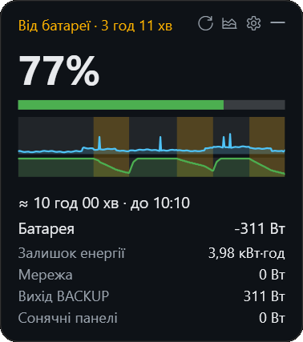
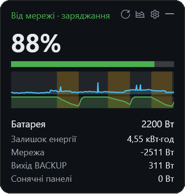
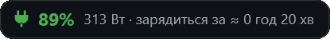
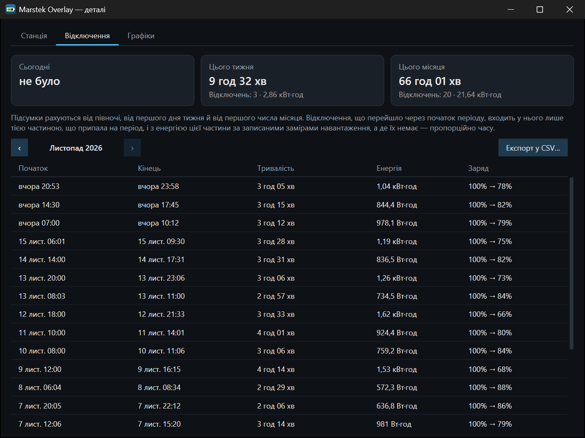
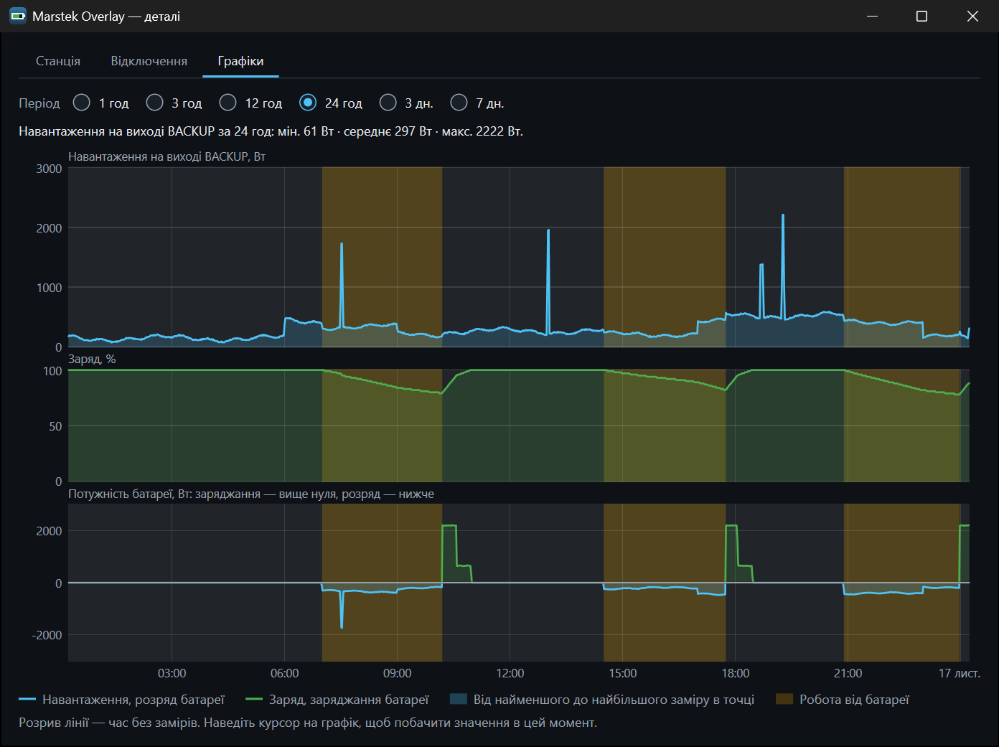
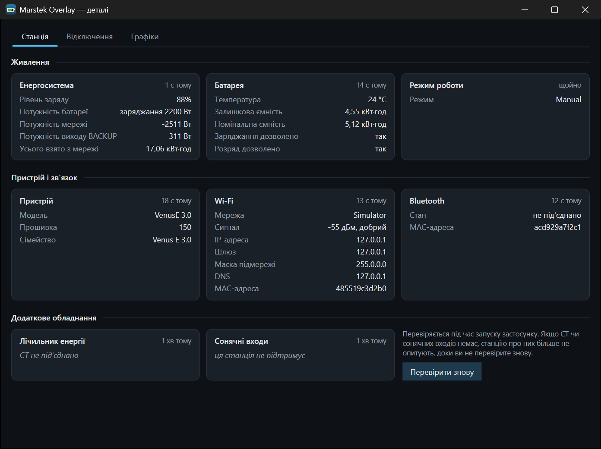
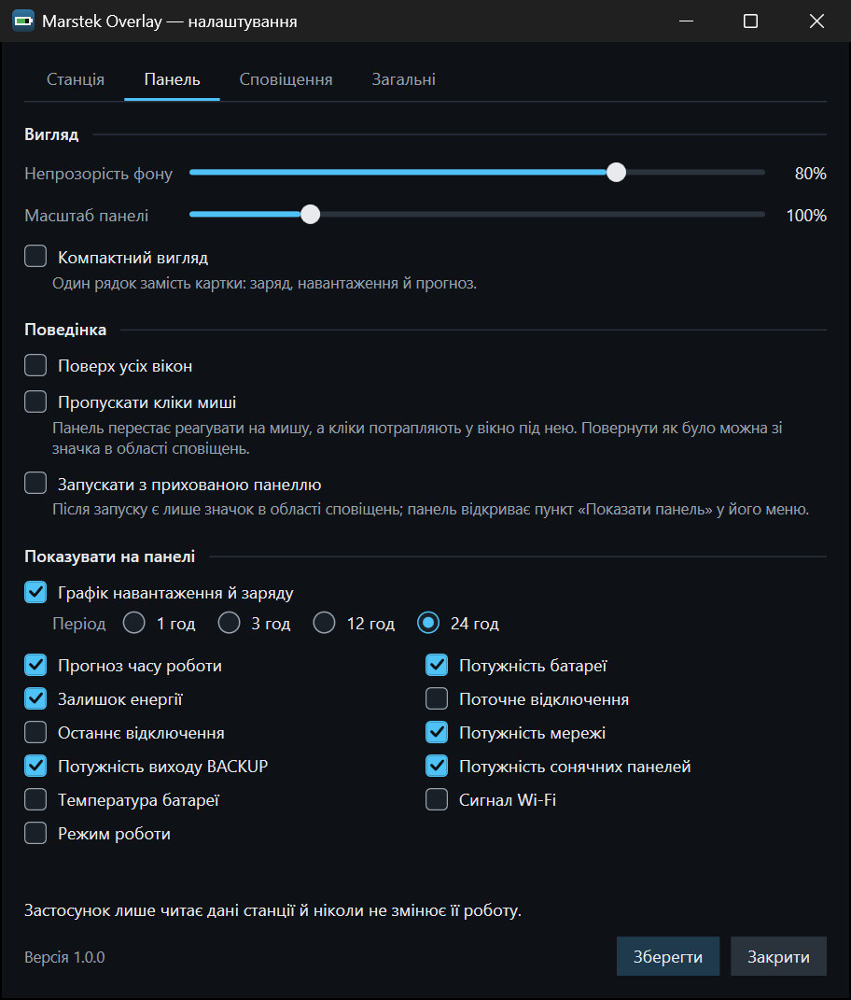

# Marstek Overlay

[English](README.md) · **Українська**

Напівпрозора панель для Windows, що показує стан зарядної станції Marstek (Venus A / C / D / E / E mini): звідки зараз живлення, скільки заряду лишилося й на скільки його вистачить. Дані беруться зі станції напряму через її локальний Open API у домашній мережі, без хмари. Застосунок лише читає — на станції він нічого не змінює.

Найкраще він підходить для станції, що працює як безперебійник: навантаження на виході BACKUP, мережа на вході.

  
  &nbsp;&nbsp;
  

  

> Незалежний проєкт, не пов'язаний із Marstek і не схвалений нею.

## Що він уміє

- **Одразу показує джерело живлення** — від мережі, заряджання чи від батареї та як довго.
- **Прогнозує час роботи** — доки заряд знизиться до резерву, доки батарея зарядиться або на скільки її вистачило б, якби мережа зникла зараз.
- **Сповіщає через Windows**, коли мережа зникла чи повернулася, заряд знизився до порога, батарея перегрілася чи переохолола або станція перестала відповідати.
- **Веде журнал відключень** по місяцях, із підсумками та експортом у CSV.
- **Малює графіки** навантаження, заряду й потужності батареї за період до тижня.
- **Живе в треї** як значок-батарейка, що показує заряд; панель має компактний вигляд в один рядок і режими пропускання кліків та «поверх усіх вікон».
- **Розмовляє англійською та українською.**
- **Працює локально**: без облікового запису й хмари, нічого нікуди не надсилає, крім запитів до станції.

## Початок роботи

Потрібні Windows 10 або 11 (x64), комп'ютер і станція в одній локальній мережі та ввімкнений у застосунку Marstek Open API (Local API) із заданим UDP-портом (типово 30000).

Візьміть файл з [останнього релізу](https://github.com/Qyperion/MarstekOverlay/releases/latest):

| Файл | Що це |
|---|---|
| `MarstekOverlay-Setup-<версія>.exe` | **Інсталятор — звичайний вибір.** Встановлює для поточного користувача без прав адміністратора й більше нічого не потребує. |
| `MarstekOverlay-<версія>-win-x64-self-contained.exe` | Портативна версія: один файл, який більше нічого не потребує. Покладіть його будь-куди й запустіть. |
| `MarstekOverlay-<версія>-win-x64.exe` | Портативна версія: один малий файл, який потребує [.NET 11 Desktop Runtime](https://dotnet.microsoft.com/download/dotnet/11.0). |

Файли не підписані, тож під час першого запуску Windows SmartScreen може сказати, що видавець невідомий: **Докладніше → Виконати в будь-якому разі**.

Під час першого запуску відкриється вікно налаштувань: натисніть **Знайти станції в мережі**, виберіть свою, потім **Перевірити підключення** і **Зберегти**.

Оновлення — новіший інсталятор або новіший exe на місці старого — зберігає налаштування й історію: вони лежать окремо від програми, у `%APPDATA%\MarstekOverlay`.

## Панель і значок у треї

- **Заголовок** — джерело живлення: «Від мережі», «Від мережі · заряджання» або «Від батареї · 2 год 15 хв». Тривалість позначено «щонайменше», якщо застосунок не бачив самого перемикання.
- **Заряд** — число й смуга, що жовтіє від найвищого порога сповіщень і червоніє від найнижчого.
- **Графік** навантаження й заряду за останні 1–24 години; час роботи від батареї виділено жовтим.
- **Попередження** — наприклад «⚠ Низький заряд (поріг 30%)», поки вони чинні.
- **Рядки** — потужність батареї, мережі, виходу BACKUP і сонячних панелей, а під час роботи від батареї ще й прогноз. У налаштуваннях можна додати залишок енергії, поточне й останнє відключення, температуру батареї, сигнал Wi-Fi та режим роботи.

Клацання по панелі й перетягування не забирають клавіатуру у вікна, з яким ви працюєте. Контекстне меню панелі та меню значка в треї перемикають режими: **Компактний вигляд** (один рядок, «100% 575 Вт · ≈ 7 год 10 хв»), **Поверх усіх вікон** і **Пропускати кліки миші** — його вимикають зі значка в треї, бо панель тоді не реагує на мишу.

Значок у треї — батарейка, заповнена відповідно до заряду. Жовтий трикутник означає роботу від батареї, червоний хрестик — станція не відповідає; подвійне клацання ховає або показує панель.

## Прогноз

- **Від батареї** — доки заряд знизиться до рівня резерву: «≈ 9 год 00 хв · до 07:40 завтра».
- **Під час заряджання** — коли батарея зарядиться повністю: «Зарядиться за ≈ 1 год 20 хв · до 00:10».
- **Від мережі із зарядженою батареєю** — на скільки вистачило б батареї, якби мережа зникла зараз: «Вистачить на ≈ 14 год 30 хв».

Прогноз спирається на середню потужність за останні 5 хвилин. Від мережі його видно в компактному рядку й у підказці значка в треї, а не на панелі. Рівень резерву й втрати на розряд і заряджання задаються на вкладці **Загальні** в налаштуваннях.

## Сповіщення

| Сповіщення | Коли |
|---|---|
| Мережа зникла | станція перейшла на батарею |
| Станція працює від батареї | відключення почалося, коли застосунок не стежив за станцією: його запущено під час відключення, комп'ютер спав або станція довго не відповідала |
| Мережа повернулася | відключення закінчилося; у тексті — його тривалість і спожита енергія |
| Заряд знизився до порога | типові пороги — 50, 30 і 15% |
| Температура батареї поза межами | типово 5–45 °C |
| Заборонено заряджання або розряд | так повідомила сама станція |
| Станція не відповідає | типово довше 5 хвилин |

Кожне приходить один раз і не повторюється, доки причина не зникне. Види, пороги й межі задаються на вкладці **Сповіщення**.

## Вікно «Деталі»

- **Станція** — усе, що повідомляє станція, картками: енергосистема, батарея, режим роботи, пристрій, Wi-Fi, Bluetooth, лічильник енергії та сонячні входи. Картка, дані якої перестали оновлюватися, жовтіє.
- **Відключення** — журнал по місяцях: початок, кінець, тривалість, спожита енергія, зміна заряду, з підсумками за сьогодні, цей тиждень і цей місяць. **Експорт у CSV…** зберігає місяць у файл для Excel.
- **Графіки** — навантаження, заряд і потужність батареї за період від години до тижня.

  

  

Ще скріншоти: вкладка «Станція» й налаштування

  

  

## Налаштування й дані

Вікно налаштувань має чотири вкладки: **Станція** (адреса, пошук, перевірка підключення), **Панель** (вигляд, поведінка й те, що вона показує), **Сповіщення** та **Загальні** (мова, запуск разом із Windows, прогноз, видалення збережених даних). Вигляд панелі застосовується одразу, адреса станції та числа — після **Зберегти**.

Дані застосунку лежать у `%APPDATA%\MarstekOverlay`: налаштування в `settings.json`, журнал відключень і заміри для графіків у `history.db`, журнал роботи в `diagnostics.log`. Журнал відключень зберігається, доки його не видалити, заміри — 7 діб. **Видалення збережених даних** на вкладці **Загальні** очищає заміри, журнал відключень або журнал роботи — повністю або все, крім останньої доби, тижня чи місяця.

Станція опитується раз на 30 секунд. Інтервали, глибина історії та запити, які не надсилаються ніколи, задаються в `appsettings.json` поруч з exe; портативний exe постачається без цього файла, тож створіть його там — див. [docs/Configuration.md](docs/Configuration.md).

## Що варто знати

- **Станція не повідомляє, чи є мережа,** тому застосунок робить висновок із її показів. Правило розраховане на станцію, що заряджається до 100% щоразу, коли мережа є. Якщо заряджання обмежено розкладом чи рівнем, робота від мережі без заряджання виглядатиме як відключення.
- **Відключення оголошується із запізненням до хвилини,** а якщо воно почалося на повній батареї — ще на кілька хвилин пізніше: лише коли заряд опуститься до 99% і протримається так дві хвилини. Таке відключення датується цим падінням, тож його тривалість і енергію позначено «щонайменше».
- **Якщо станція поводиться нестабільно,** спробуйте вимкнути запит `Bat.GetStatus`: за повідомленнями спільноти, деякі прошивки від нього перезавантажуються. Для цього додайте `"Bat.GetStatus"` до `Polling:DisabledMethods` в `appsettings.json`.
- **Якщо в застосунку стався збій,** він показує помилку й шлях до журналу роботи і закривається; запустіть його знову.
- Перевірено на Venus E 3.0 з прошивкою 150. Повідомлення про інші моделі й прошивки — в [issues](https://github.com/Qyperion/MarstekOverlay/issues/new/choose).

## Документація

Технічні подробиці — англійською, у теці [docs](docs):

- [Architecture.md](docs/Architecture.md) — з чого складається застосунок
- [MarstekLocalApi.md](docs/MarstekLocalApi.md) — протокол станції: методи, поля, одиниці за прошивками
- [StationBehaviour.md](docs/StationBehaviour.md) — що виміряно на справжній станції
- [PowerSourceAndOutages.md](docs/PowerSourceAndOutages.md) — як визначається джерело живлення, журнал відключень
- [ForecastAndAlerts.md](docs/ForecastAndAlerts.md) — прогноз і сповіщення
- [HistoryAndCharts.md](docs/HistoryAndCharts.md) — історія замірів і графіки
- [DesktopUi.md](docs/DesktopUi.md) — панель, значок, вікна, локалізація
- [Configuration.md](docs/Configuration.md) — файли налаштувань і всі їхні ключі
- [BuildAndRelease.md](docs/BuildAndRelease.md) — збірка з коду, інсталятор, релізи

Як зібрати застосунок, перевірити зміну без станції і чого зміна має дотримуватися — у [CONTRIBUTING.md](CONTRIBUTING.md) (англійською).

## Ліцензія

[MIT](LICENSE). Бібліотеки, на яких побудовано застосунок, перелічено в [THIRD-PARTY-NOTICES.md](THIRD-PARTY-NOTICES.md).

Marstek і Venus — торговельні марки їхнього власника; проєкт уживає ці назви лише щоб сказати, з якими пристроями він працює.
